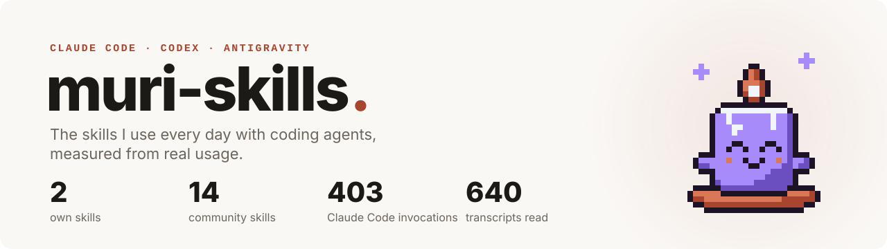
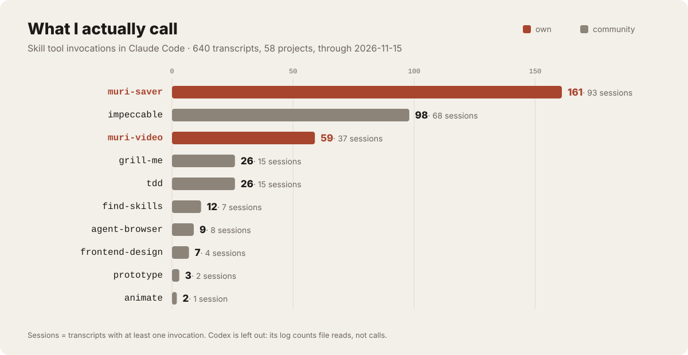
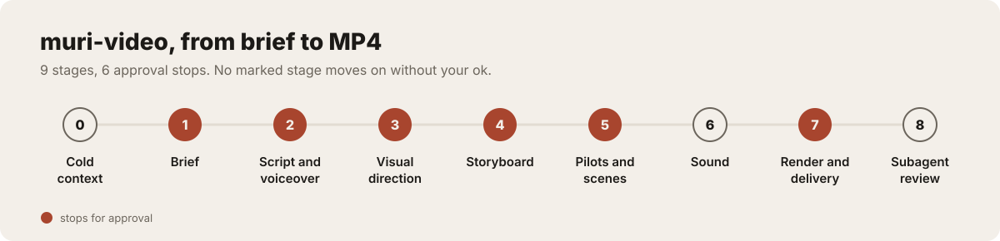

<!-- gerado:banner -->
<picture>
  <source media="(prefers-color-scheme: dark)" srcset="assets/readme/banner-escuro.en.svg">
  
</picture>
<!-- /gerado:banner -->

<p align="center">
  <a href="README.md">Português</a> &nbsp;·&nbsp; <b>English</b>
</p>

<p align="center">
  <a href="#own-skills">Own skills</a> &nbsp;·&nbsp;
  <a href="#daily-stack">Daily stack</a> &nbsp;·&nbsp;
  <a href="#install">Install</a> &nbsp;·&nbsp;
  <a href="#how-the-numbers-were-measured">Methodology</a> &nbsp;·&nbsp;
  <a href="https://github.com/murilolol/muri-saver">muri-saver</a>
</p>

The skills I use every day in **Claude Code**, **Codex** and **Antigravity**. Two are mine and ship here in full. The rest belong to other authors and appear as a curated stack: link, author, license, how much I use it and why. No third-party code is copied into this repository.

> [!NOTE]
> The numbers come from my local transcripts, not from surveys or GitHub stars. The [methodology](#how-the-numbers-were-measured) explains the count and how to reproduce it on your machine.

## Why this exists

I audit my own agent usage. That is how [muri-saver](https://github.com/murilolol/muri-saver) started: real transcripts showed where the quota went, and every rule in the kit answers a measured finding. This repository applies the same idea to skills. Instead of a list of favorites, what gets in is what the logs say I actually call.

<!-- gerado:uso -->
<picture>
  <source media="(prefers-color-scheme: dark)" srcset="assets/readme/uso-escuro.en.svg">
  
</picture>
<!-- /gerado:uso -->

<!-- TODO: presentation video made with muri-video itself. Upload the MP4 through the GitHub web editor and paste the github.com/user-attachments/assets/<uuid> URL here, followed by the "open the video" link in <sub> and the 3×2 table of stills in assets/video/. -->

## Own skills

### muri-saver

An aggressive context and quota saving mode for coding agents. Say "muri saver" and the session follows short rules: don't reread what was already read, run independent calls in parallel, text before screenshots, short sessions per topic. The mode stays on until you turn it off.

<!-- gerado:uso-muri-saver -->
<sub>161 invocations in 93 sessions in Claude Code · 52 Codex mentions</sub>
<!-- /gerado:uso-muri-saver -->

This folder holds only the skill ([`skills/muri-saver/`](skills/muri-saver/)): `SKILL.md` plus the references for agents, auditing, delegation and memory. The full kit, with hooks, status line, context guard, live Obsidian notes and an installer, lives at **[murilolol/muri-saver](https://github.com/murilolol/muri-saver)**.

### muri-video

A pipeline for narrated presentation videos: company, product, results or portfolio. The skill runs the brief in rounds, writes the script for TTS, proposes three visual directions, builds the storyboard and only then produces the scenes in Remotion (or [HyperFrames](https://github.com/heygen-com/hyperframes), by HeyGen, Apache-2.0), with music, sound effects and renders in 16:9 and 9:16, up to 4K, with and without music. At the end a subagent reviews the film before delivery.

<!-- gerado:uso-muri-video -->
<sub>59 invocations in 37 sessions in Claude Code · 1,369 Codex mentions</sub>
<!-- /gerado:uso-muri-video -->

<!-- gerado:pipeline -->
<picture>
  <source media="(prefers-color-scheme: dark)" srcset="assets/readme/pipeline-escuro.en.svg">
  
</picture>
<!-- /gerado:pipeline -->

What ships in [`skills/muri-video/`](skills/muri-video/):

| Path | What it is |
|---|---|
| `SKILL.md` | Flow, golden rules and tools |
| `references/` | Brief, voiceover, motion, Remotion, HyperFrames, sound, render, promo pieces, review and lessons learned |
| `cli/muri.mjs` | The `muri` CLI: `novo`, `versao`, `status`, `entregar`, `arquivar`, `retomar`. Each version is a worktree and is never overwritten. Tests with `node --test` in `cli/` |
| `scripts/` | Standalone project from the template, and HyperFrames skills enabled only inside the project |
| `ferramentas/` | QA contact sheets, audio sync and level analysis, real-screen capture at 2× |
| `template/hyperframes/` | Base composition for short pieces in HTML and GSAP |

> [!IMPORTANT]
> The Remotion scenes come from a separate template repository that is not public yet. Without it, `muri novo` and `scripts/novo-projeto.sh` stop with "Template não encontrado". Point `MURI_VIDEO_REPO` at your own Remotion repository (branch `main`) or use the HyperFrames engine, which works with this folder alone.

The skill text is in Portuguese. Requirements: Node 18+, FFmpeg, whisper-cpp and Python 3.11 for local voiceover (`brew install ffmpeg whisper-cpp` and `pip3 install kokoro-onnx soundfile transformers torch numpy`). Optional: the Orca app (`MURI_ORCA_BIN`) to list each version as a worktree; without it the CLI only warns and carries on. muri-video orchestrates `video-shotcraft`, `remotion-best-practices` and `grill-me`, listed in the stack below.

## Daily stack

Skills by other authors that show up in my logs, sorted by Claude Code invocations, then by Codex mentions. Each keeps its original license; install it with the author's command.

<!-- gerado:stack -->
| Skill | Author | License | Claude Code¹ | Codex² | Why it is here |
|---|---|---|---|---|---|
| [`impeccable`](https://github.com/pbakaus/impeccable) | [Paul Bakaus](https://github.com/pbakaus) | Apache-2.0 | 98 in 68 sessions | 672 mentions | Critique and polish of every screen before it ships. The third-party skill I call most. |
| [`grill-me`](https://github.com/mattpocock/skills) | [Matt Pocock](https://github.com/mattpocock) | MIT | 26 in 15 sessions | 11 mentions | Before any big plan: rounds of questions until nothing is left open. muri-video asks the same way. |
| [`tdd`](https://github.com/mattpocock/skills) | [Matt Pocock](https://github.com/mattpocock) | MIT | 26 in 15 sessions | 10 mentions | Bugs and features start from a failing test, with integration tests instead of mocks. |
| [`find-skills`](https://github.com/vercel-labs/skills) | [Vercel Labs](https://github.com/vercel-labs) | MIT | 12 in 7 sessions | — | Before writing a skill, I check whether someone already has. |
| [`agent-browser`](https://github.com/vercel-labs/agent-browser) | [Vercel Labs](https://github.com/vercel-labs) | Apache-2.0 | 9 in 8 sessions | 29 mentions | Test the app in a real browser without leaving the terminal. Needs the agent-browser CLI. |
| [`frontend-design`](https://github.com/anthropics/skills/tree/main/skills/frontend-design) | [Anthropic](https://github.com/anthropics) | Apache-2.0 | 7 in 4 sessions | 20 mentions | Visual direction when a screen starts from scratch. |
| [`prototype`](https://github.com/emilkowalski/skills) | [Emil Kowalski](https://github.com/emilkowalski) | MIT | 3 in 2 sessions | — | Three or four versions of a component behind a picker, so the decision is made by looking. |
| [`animate`](https://github.com/emilkowalski/skills) | [Emil Kowalski](https://github.com/emilkowalski) | MIT | 2 in 1 session | 59 mentions | Decides whether something should animate before deciding how. |
| [`video-shotcraft`](https://github.com/Vincentwei1021/video-shotcraft) | [Wei Yihao (Vincent Wei)](https://github.com/Vincentwei1021) | Apache-2.0 | — | 1,535 mentions | Shot gallery and sound library that muri-video orchestrates. It gets loaded through it. |
| [`emil-design-eng`](https://github.com/emilkowalski/skills) | [Emil Kowalski](https://github.com/emilkowalski) | MIT | — | 64 mentions | UI polish and motion judgment when the UI work runs in Codex. |
| [`test-driven-development`](https://github.com/obra/superpowers) | [Jesse Vincent](https://github.com/obra) | MIT | — | 62 mentions | Superpowers' strict TDD, the Codex-side counterpart of tdd. |
| [`graphify`](https://github.com/Graphify-Labs/graphify) | [Graphify Labs](https://github.com/Graphify-Labs) | Apache-2.0 | — | 46 mentions | I ask the repo graph before grepping around. In Claude it runs through the CLI, so it never shows as an invocation. |
| [`design-taste-frontend`](https://github.com/Leonxlnx/taste-skill) | [Leonxlnx](https://github.com/Leonxlnx) | MIT | — | 24 mentions | Second opinion against template-looking layouts on landing pages. |
| [`remotion-best-practices`](https://github.com/remotion-dev/skills) | [Remotion](https://github.com/remotion-dev) | no license file | — | 16 mentions | Remotion API answers when a specific question comes up mid-video. |

<sub>¹ Skill tool invocations, and in how many sessions.<br>² Mentions of the skill's paths in Codex logs. Every file read inflates it, so read it as an order of magnitude, not against Claude.<br>Left out of the table: skills that ship with the client (computer-use, claude-in-chrome, chrome-browser, dataviz, design, web-design-guidelines), local or private skills, the local openspec and gstack (54 Codex mentions), which is a bundle of 23 tools rather than a single skill.</sub>
<!-- /gerado:stack -->

## Install

**Own skills.** Copy the skill folder into your agent's skills directory:

```bash
git clone https://github.com/murilolol/muri-skills.git
for s in muri-saver muri-video; do
  cp -R muri-skills/skills/$s ~/.claude/skills/   # Claude Code reads ~/.claude/skills
  cp -R muri-skills/skills/$s ~/.agents/skills/   # Codex, Antigravity and others read ~/.agents/skills
done
```

To use the muri-video CLI as `muri`: `ln -s "$PWD/muri-skills/skills/muri-video/cli/muri.mjs" ~/.local/bin/muri`. Videos go to `~/videos/muri-video` by default; change it with `MURI_ORCA_RAIZ`.

**Third-party stack.** Use each author's official command:

<!-- gerado:instalar -->
<details>
<summary>Install command for every stack skill</summary>

```bash
# impeccable (Paul Bakaus, Apache-2.0)
npx impeccable install

# grill-me (Matt Pocock, MIT)
npx skills@latest add mattpocock/skills --skill grill-me

# tdd (Matt Pocock, MIT)
npx skills@latest add mattpocock/skills --skill tdd

# find-skills (Vercel Labs, MIT)
npx skills add vercel-labs/skills --skill find-skills

# agent-browser (Vercel Labs, Apache-2.0)
npx skills add vercel-labs/agent-browser

# frontend-design (Anthropic, Apache-2.0), inside Claude Code
/plugin marketplace add anthropics/skills
/plugin install example-skills@anthropic-agent-skills

# prototype (Emil Kowalski, MIT)
npx skills@latest add emilkowalski/skills --skill prototype

# animate (Emil Kowalski, MIT)
npx skills@latest add emilkowalski/skills --skill animate

# video-shotcraft (Wei Yihao (Vincent Wei), Apache-2.0)
npx skills add Vincentwei1021/video-shotcraft

# emil-design-eng (Emil Kowalski, MIT)
npx skills@latest add emilkowalski/skills --skill emil-design-eng

# test-driven-development (Jesse Vincent, MIT), inside Claude Code
/plugin install superpowers@claude-plugins-official

# graphify (Graphify Labs, Apache-2.0)
uv tool install graphifyy && graphify install

# design-taste-frontend (Leonxlnx, MIT)
npx skills add https://github.com/Leonxlnx/taste-skill --skill "design-taste-frontend"

# remotion-best-practices (Remotion, no license file)
npx skills add remotion-dev/skills
```

</details>
<!-- /gerado:instalar -->

## How the numbers were measured

- **Claude Code:** every `tool_use` block of the `Skill` tool in the local transcripts (`~/.claude/projects/**/*.jsonl`) counts as one invocation. Sessions are the transcripts with at least one invocation of that skill.
- **Codex:** every `<skill>/` path in the `~/.codex/sessions` logs counts as one mention. File reads inside the skill count too, which is why a large skill like `video-shotcraft` shows thousands of mentions. Read it as an order of magnitude, not against Claude.
- **Antigravity:** not part of this measurement.
- **Left out of the table:** skills that ship with the client, local skills with no verified upstream, and any private skill.
- **Upstream:** repository, author, license and install command for each skill were checked on GitHub on the measurement date.

To reproduce in Claude Code:

```bash
find ~/.claude/projects -name '*.jsonl' \
  -exec grep -oh '"name":"Skill","input":{"skill":"[^"]*"' {} + \
  | sed 's/.*"skill":"//; s/"$//' | sort | uniq -c | sort -rn
```

Every number in the READMEs, the banner and the charts comes from one file, [`assets/readme/dados.json`](assets/readme/dados.json). `npm run build` regenerates the 12 SVGs (light and dark, Portuguese and English) and rewrites the generated parts of both READMEs; the script checks the data before writing.

## License and credits

The own skills (`skills/muri-saver` and `skills/muri-video`) and the scripts in this repository are MIT licensed ([`LICENSE`](LICENSE)). The stack skills are not distributed here and keep each author's license: [Paul Bakaus](https://github.com/pbakaus), [Matt Pocock](https://github.com/mattpocock), [Emil Kowalski](https://github.com/emilkowalski), [Vercel Labs](https://github.com/vercel-labs), [Anthropic](https://github.com/anthropics), [Jesse Vincent](https://github.com/obra), [Graphify Labs](https://github.com/Graphify-Labs), [Wei Yihao (Vincent Wei)](https://github.com/Vincentwei1021), [Leonxlnx](https://github.com/Leonxlnx) and [Remotion](https://github.com/remotion-dev). The [HyperFrames](https://github.com/heygen-com/hyperframes) engine, which muri-video enables per project, is by [HeyGen](https://github.com/heygen-com) (Apache-2.0).

Made by [@murilolol](https://github.com/murilolol).

<sub>The banner and charts are generated from <a href="assets/readme/dados.json">assets/readme/dados.json</a> by <a href="tools/build-assets.mjs">tools/build-assets.mjs</a>. The mascot is Pavio, the same one as in muri-saver.</sub>
