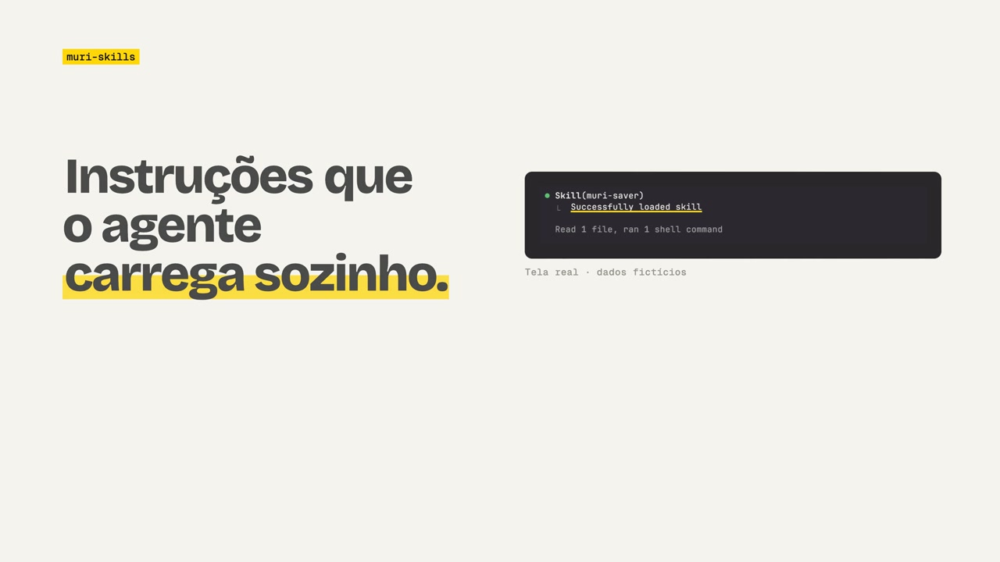
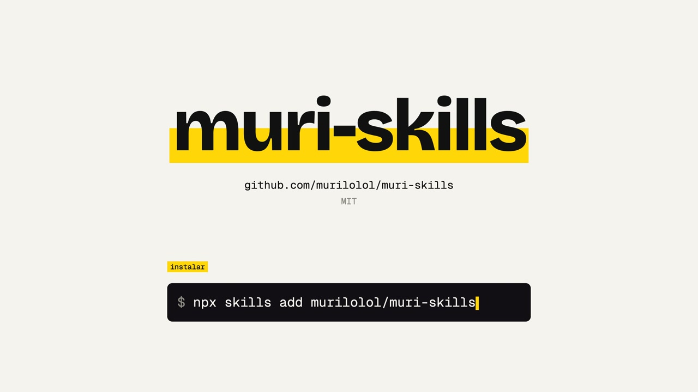
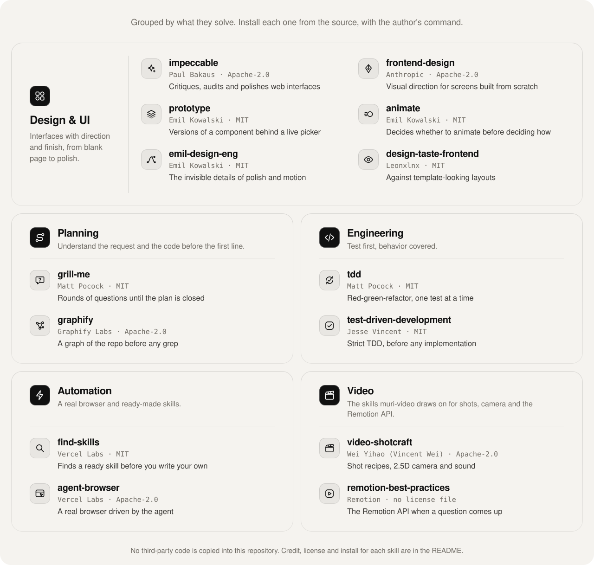

<picture>
  <source media="(prefers-color-scheme: dark)" srcset="assets/readme/hero-dark.en.svg">
  
</picture>

<p align="center">
  <a href="README.md">Português</a> &nbsp;·&nbsp; <b>English</b>
</p>

<p align="center">
  <a href="#01--muri-video">muri-video</a> &nbsp;·&nbsp;
  <a href="#02--muri-saver">muri-saver</a> &nbsp;·&nbsp;
  <a href="#03--muri-design">muri-design</a> &nbsp;·&nbsp;
  <a href="#04--curated-stack">Curated stack</a> &nbsp;·&nbsp;
  <a href="#install">Install</a>
</p>

A skill is a folder with a `SKILL.md`: instructions, references and scripts that a coding agent loads by itself when the task calls for it. This repository holds the three skills I wrote and the third-party stack I use alongside them, with credit to every author.

It is for people who work with **Claude Code**, **Codex** or **Antigravity** and want the agent to deliver finished work, not drafts. Install only what solves your problem.

https://github.com/user-attachments/assets/55dd9c05-ae6c-4bb2-bb28-1ceb2cdea539

<sub><b>Turn the sound on:</b> the video is narrated in Portuguese and GitHub's player starts muted. If it doesn't load, <a href="https://github.com/user-attachments/assets/55dd9c05-ae6c-4bb2-bb28-1ceb2cdea539">open the video</a>. Made with muri-video itself, in 58 s; real agent screens on a fictional project.</sub>

<details>
<summary>English transcript</summary>

Coding agents write fast. But they deliver half the job: the draft looks finished, and the polish is left to you.

muri-skills changes that. They're skills, instructions the agent loads by itself, so it works with a process from request to delivery.

Ask for a video, and muri-video runs it like a production studio: brief, script, visual direction, scenes and render. At every stage it stops and waits for your ok. This video was made that way.

In a long session, muri-saver cuts the waste: the agent doesn't re-read what it already read, suggests a new session when the subject changes, and doesn't skip a single test to save.

For everything else, a curated stack by other authors, with credit and license for each one. Install only what solves your problem.

Works in Claude Code, Codex and Antigravity. One line to install. Free and open source.

</details>

<table>
  <tr>
    <td width="33%"><br><sub><b>The problem:</b> the draft looks finished</sub></td>
    <td width="33%"><br><sub><b>The idea:</b> instructions the agent loads by itself</sub></td>
    <td width="33%"><br><sub><b>muri-video:</b> stops at every stage for your ok</sub></td>
  </tr>
  <tr>
    <td><br><sub><b>muri-saver:</b> no re-reading, one session per subject</sub></td>
    <td><br><sub><b>Stack:</b> credit and license for every author</sub></td>
    <td><br><sub><b>Install:</b> one line</sub></td>
  </tr>
</table>

## 01 · muri-video

<picture>
  <source media="(prefers-color-scheme: dark)" srcset="assets/readme/card-muri-video-dark.en.svg">
  
</picture>

<!-- gerado:muri-video -->
**What it is for.** Walks the agent through a production-studio process for company, product, results or portfolio videos. It runs the brief as rounds of questions, writes the script for voiceover, proposes visual directions and a storyboard, and builds the scenes in Remotion (or HyperFrames) with 2.5D camera moves, sound and captions. Every stage marked ✋ pauses for your approval.

**When to use it.** Company profile · product launch · results and data · portfolio · social video. Ask like this: `muri video, make the launch video for the app`

**What you get.** Four MP4s (16:9 and 9:16, with and without music, up to 4K) and VTT captions; when you ask, story and feed cuts with copy per network and a final review by a subagent.

```bash
npx skills add murilolol/muri-skills --skill muri-video
```
<!-- /gerado:muri-video -->

<details>
<summary>How it works, stage by stage</summary>

Each ✋ is a point where the skill stops and waits for your OK.

0. **Cold context.** Reads memory, theme tokens, screens and where the product's data comes from.
1. **Brief ✋.** Rounds of questions with the recommended option first, in the style of `grill-me`.
2. **Script and voiceover ✋.** Per-scene text written for the voice; the text is approved before any TTS quota is spent.
3. **Visual direction ✋.** Three styleframes side by side; you pick one.
4. **Storyboard ✋.** Part, timing, what is on screen, shot and sound for each stretch.
5. **Production ✋.** Two pilots first, with frame QA in 16:9 and 9:16; then the remaining scenes, one at a time.
6. **Sound.** Music and effects once the picture is locked, with each sound's peak on the action's frame.
7. **Render and delivery ✋.** Formats in parallel, audio at −16 LUFS, VTT and the four MP4s; social cuts when requested.
8. **Final review.** A subagent reviews the film; the required fixes go in before delivery.

**Engine.** Remotion by default, for long, narration-driven, data-heavy videos. [HyperFrames](https://github.com/heygen-com/hyperframes) (HeyGen, Apache-2.0) for short pieces in HTML and GSAP; its skills are enabled inside the project only.

| Path | What it is |
|---|---|
| `SKILL.md` | Flow, golden rules and tools |
| `references/` | Brief, voiceover, motion, Remotion, HyperFrames, sound, render, social cuts, review and lessons learned |
| `cli/muri.mjs` | The `muri` CLI: `novo`, `versao`, `status`, `entregar`, `arquivar`, `retomar`. Each version is a worktree and is never overwritten |
| `scripts/` | A standalone project from the template, and per-project activation of the HyperFrames skills |
| `ferramentas/` | QA contact sheets, audio sync and level analysis, 2× captures of real screens |
| `template/hyperframes/` | Base composition for short pieces |

**Requirements.** Node 18+, FFmpeg and whisper-cpp (`brew install ffmpeg whisper-cpp`); Python 3.11 for local voiceover (`pip3 install kokoro-onnx soundfile transformers torch numpy`). The skill's text is in Portuguese; agents follow it in any language.

> [!IMPORTANT]
> The Remotion scenes come from a template of my own that is not public yet. Without it, `muri novo` stops with "Template não encontrado": point `MURI_VIDEO_REPO` at a Remotion repository of yours (branch `main`) or use the HyperFrames engine, which works with this folder alone.

</details>

## 02 · muri-saver

<picture>
  <source media="(prefers-color-scheme: dark)" srcset="assets/readme/card-muri-saver-dark.en.svg">
  
</picture>

<!-- gerado:muri-saver -->
**What it is for.** A mode that stays on for the whole conversation and changes how the agent works. It searches before reading, never rereads what is already in context, batches independent calls, prefers page text to a screenshot and suggests a new session when the topic changes. With the full kit, mechanical work goes to another quota (Gemini sweeps and summarizes, Codex reviews and implements with your OK) and the handoff between sessions is automatic.

**When to use it.** Long, slow session · agent rereading files · quota running out early · heavy mechanical task. Ask like this: `muri saver`

**What you get.** Direct answers, fewer repeated reads and sessions that end at the right time, so the plan quota lasts the week. No needed test is skipped and no requirement is dropped to save tokens.

```bash
npx skills add murilolol/muri-skills --skill muri-saver
```
<!-- /gerado:muri-saver -->

Turn it on with `muri saver`; it stays on until you say `sair do muri-saver` or simply ask to turn it off. This folder holds the skill and its rules; delegation and the automatic handoff come with the **[full kit](https://github.com/murilolol/muri-saver)**, which has the hooks, the context guard, the status line, the Gemini and Codex delegate and the installer.

<details>
<summary>Rules, delegation and per-task profiles</summary>

**Rules that stay on**

- Answers with no preamble and no recap; no repeating code or output already shown.
- Search before reading, read the excerpt, never reread a file that is already in context.
- Independent calls go out together; tool schemas are loaded once.
- Never switches models on its own; a mechanical task at high effort becomes a one-sentence suggestion.
- Task done and an unrelated new request: suggests a new session; with the kit, the handoff is automatic.
- Never skips a needed test, drops a requirement or stops early to save tokens.

**Who does what** (with the full kit)

| Task | Who |
|---|---|
| Wide sweep, "how does X work", log summary, research, doc draft | Gemini |
| Code review, second opinion | Codex, read-only |
| Well-specified implementation, boilerplate, mass refactor, tests | Codex with write access, after your OK |
| Architecture, ambiguous decisions, final diff review, conversation | your agent |

**Profiles.** Backend, frontend, browser and QA, docs, git, debug, scaffold and refactor each have their own rules in the [`SKILL.md`](skills/muri-saver/SKILL.md).

</details>

## 03 · muri-design

<picture>
  <source media="(prefers-color-scheme: dark)" srcset="assets/readme/card-muri-design-dark.en.svg">
  
</picture>

<!-- gerado:muri-design -->
**What it is for.** The rules I apply when I design for a product, taken from what I approved and rejected on real projects. The agent reads the product's identity before drawing, uses a plain base with a single accent, shows real screens instead of invented UI, cuts decorative effects and gives each screen its own layout. The process comes with it: a short brief, three options side by side, an approved pilot before scaling, QA on a contact sheet and an independent review.

**When to use it.** New interface or site · redesign · carousels and posts · README and product visuals. Ask like this: `muri design`

**What you get.** Visuals that look like the product and not like a template, a rejection checklist applied before anything is shown to you, and an approval point before scaling. For execution and polish, it pairs with impeccable, emil-design-eng and frontend-design from the stack.

```bash
npx skills add murilolol/muri-skills --skill muri-design
```
<!-- /gerado:muri-design -->

The full rules, the process and the rejection checklist are in [`SKILL.md`](skills/muri-design/SKILL.md). They come from real feedback I gave on projects, approving and rejecting work; where they overlap with stack skills, the credit is at the end of the file.

## 04 · Curated stack

<picture>
  <source media="(prefers-color-scheme: dark)" srcset="assets/readme/stack-dark.en.svg">
  
</picture>

Skills by other authors that work alongside mine. None of their code is copied here: each keeps its original license and is installed with the author's own command.

<!-- gerado:stack -->
<details>
<summary><b>Design & UI</b> · impeccable, frontend-design, prototype, animate, emil-design-eng, design-taste-frontend</summary>

| Skill | What it is for | Ask like this |
|---|---|---|
| [`impeccable`](https://github.com/pbakaus/impeccable)<br><sub>[Paul Bakaus](https://github.com/pbakaus) · Apache-2.0</sub> | A design kit for the agent: critique, audit, polish, typography, color, layout, motion and accessibility for web screens. It points out what looks generic and fixes it.<br><sub>You get: A prioritized diagnosis and the adjusted screen.</sub> | <sub>“critique this screen before I ship it”</sub> |
| [`frontend-design`](https://github.com/anthropics/skills/tree/main/skills/frontend-design)<br><sub>[Anthropic](https://github.com/anthropics) · Apache-2.0</sub> | Guides aesthetic direction, typography and composition when an interface is new or being reshaped, so it does not come out looking like a template.<br><sub>You get: An interface with a clear, coherent visual direction.</sub> | <sub>“build the landing page for this product”</sub> |
| [`prototype`](https://github.com/emilkowalski/skills)<br><sub>[Emil Kowalski](https://github.com/emilkowalski) · MIT</sub> | Builds genuinely different versions of a UI piece behind a visual picker, so you flip between them and promote the best one. Runs only when invoked.<br><sub>You get: The variants side by side and the chosen one promoted.</sub> | <sub>“/prototype three versions of the pricing card”</sub> |
| [`animate`](https://github.com/emilkowalski/skills)<br><sub>[Emil Kowalski](https://github.com/emilkowalski) · MIT</sub> | Builds an animation by making the decisions in the right order: whether to animate, why, which tool, properties, curve, duration, interruption and exit. Writes the implementation.<br><sub>You get: The animation implemented, with curve and duration justified.</sub> | <sub>“animate this modal opening”</sub> |
| [`emil-design-eng`](https://github.com/emilkowalski/skills)<br><sub>[Emil Kowalski](https://github.com/emilkowalski) · MIT</sub> | Brings Emil Kowalski's philosophy on UI polish, component design and animation decisions: the details that make software feel well made.<br><sub>You get: Fine adjustments to interaction, motion and components.</sub> | <sub>“review the finish on this component”</sub> |
| [`design-taste-frontend`](https://github.com/Leonxlnx/taste-skill)<br><sub>[Leonxlnx](https://github.com/Leonxlnx) · MIT</sub> | An anti-template skill for landing pages, portfolios and redesigns. It reads the brief, infers the direction, audits before redesigning and runs a strict pre-flight check.<br><sub>You get: A layout with its own direction, checked before delivery.</sub> | <sub>“redesign the home page so it does not look templated”</sub> |

</details>

<details>
<summary><b>Planning</b> · grill-me, graphify</summary>

| Skill | What it is for | Ask like this |
|---|---|---|
| [`grill-me`](https://github.com/mattpocock/skills)<br><sub>[Matt Pocock](https://github.com/mattpocock) · MIT</sub> | The agent interviews you about every decision in a plan until you both reach the same understanding. Useful for a big request that still has loose ends. Runs only when invoked.<br><sub>You get: An unambiguous plan with the decisions written down.</sub> | <sub>“/grill-me on this plan before we start”</sub> |
| [`graphify`](https://github.com/Graphify-Labs/graphify)<br><sub>[Graphify Labs](https://github.com/Graphify-Labs) · Apache-2.0</sub> | Turns code, docs, PDFs and media into a persistent knowledge graph with query, path and explain commands. The agent asks the graph before reading file after file.<br><sub>You get: The answer with the graph nodes and paths.</sub> | <sub>“how does payment connect to the queue?”</sub> |

</details>

<details>
<summary><b>Engineering</b> · tdd, test-driven-development</summary>

| Skill | What it is for | Ask like this |
|---|---|---|
| [`tdd`](https://github.com/mattpocock/skills)<br><sub>[Matt Pocock](https://github.com/mattpocock) · MIT</sub> | Drives features and bug fixes through red-green-refactor in vertical slices. Tests check behavior through the public interface, not implementation details.<br><sub>You get: Code covered by tests that survive refactoring.</sub> | <sub>“fix this bug starting from a test”</sub> |
| [`test-driven-development`](https://github.com/obra/superpowers)<br><sub>[Jesse Vincent](https://github.com/obra) · MIT</sub> | Part of Superpowers. It enforces one rule: no production code without a test that failed first. Write the test, watch it fail for the right reason, then write the minimum to pass.<br><sub>You get: Every change paired with the test that justifies it.</sub> | <sub>“implement the date filter”</sub> |

</details>

<details>
<summary><b>Automation</b> · find-skills, agent-browser</summary>

| Skill | What it is for | Ask like this |
|---|---|---|
| [`find-skills`](https://github.com/vercel-labs/skills)<br><sub>[Vercel Labs](https://github.com/vercel-labs) · MIT</sub> | When an "is there a skill for this?" comes up, it searches the open skills ecosystem and shows how to install the one that fits.<br><sub>You get: The options found, with the install command.</sub> | <sub>“is there a skill for accessibility reviews?”</sub> |
| [`agent-browser`](https://github.com/vercel-labs/agent-browser)<br><sub>[Vercel Labs](https://github.com/vercel-labs) · Apache-2.0</sub> | Teaches the agent to use the agent-browser CLI to open pages, click, fill forms and read the screen. Good for testing the real app and exploratory QA. Needs the CLI installed.<br><sub>You get: The flow run end to end, with what broke and the evidence.</sub> | <sub>“open the local app and test the sign-up flow”</sub> |

</details>

<details>
<summary><b>Video</b> · video-shotcraft, remotion-best-practices</summary>

| Skill | What it is for | Ask like this |
|---|---|---|
| [`video-shotcraft`](https://github.com/Vincentwei1021/video-shotcraft)<br><sub>[Wei Yihao (Vincent Wei)](https://github.com/Vincentwei1021) · Apache-2.0</sub> | Turns a frontend project into a product video with shot recipe cards, a validated Remotion template, real screens, 2.5D camera moves, beat-synced cuts and sound design. muri-video loads it during production.<br><sub>You get: A Remotion product video built from the real screens.</sub> | <sub>“turn this landing page into a product video”</sub> |
| [`remotion-best-practices`](https://github.com/remotion-dev/skills)<br><sub>[Remotion](https://github.com/remotion-dev) · no license file</sub> | The official router to Remotion's references: creating a project and composition, markup best practices and specific topics, loaded as the question requires.<br><sub>You get: The answer from the official reference, applied in code.</sub> | <sub>“how do I make an animated map in Remotion?”</sub> |

</details>
<!-- /gerado:stack -->

<!-- gerado:instalar -->
<details>
<summary>Install commands for every skill in the stack</summary>

```bash
# impeccable (Paul Bakaus, Apache-2.0)
npx impeccable install

# grill-me (Matt Pocock, MIT)
npx skills@latest add mattpocock/skills --skill grill-me

# tdd (Matt Pocock, MIT)
npx skills@latest add mattpocock/skills --skill tdd

# find-skills (Vercel Labs, MIT)
npx skills add vercel-labs/skills --skill find-skills

# agent-browser (Vercel Labs, Apache-2.0)
npx skills add vercel-labs/agent-browser

# frontend-design (Anthropic, Apache-2.0), inside Claude Code
/plugin marketplace add anthropics/skills
/plugin install example-skills@anthropic-agent-skills

# prototype (Emil Kowalski, MIT)
npx skills@latest add emilkowalski/skills --skill prototype

# animate (Emil Kowalski, MIT)
npx skills@latest add emilkowalski/skills --skill animate

# video-shotcraft (Wei Yihao (Vincent Wei), Apache-2.0)
npx skills add Vincentwei1021/video-shotcraft

# emil-design-eng (Emil Kowalski, MIT)
npx skills@latest add emilkowalski/skills --skill emil-design-eng

# test-driven-development (Jesse Vincent, MIT), inside Claude Code
/plugin install superpowers@claude-plugins-official

# graphify (Graphify Labs, Apache-2.0)
uv tool install graphifyy && graphify install

# design-taste-frontend (Leonxlnx, MIT)
npx skills add https://github.com/Leonxlnx/taste-skill --skill "design-taste-frontend"

# remotion-best-practices (Remotion, no license file)
npx skills add remotion-dev/skills
```

</details>
<!-- /gerado:instalar -->

## Install

**With the skills CLI** (it detects the agents installed on your machine):

```bash
npx skills add murilolol/muri-skills                      # lists all three and asks
npx skills add murilolol/muri-skills --skill muri-video   # just one
```

**By hand:** copy the skill folder into the directory your agent reads.

```bash
git clone https://github.com/murilolol/muri-skills.git
cp -R muri-skills/skills/muri-video ~/.claude/skills/   # Claude Code
cp -R muri-skills/skills/muri-video ~/.agents/skills/   # Codex, Antigravity and others
```

To use the muri-video CLI as `muri`: `ln -s "$PWD/muri-skills/skills/muri-video/cli/muri.mjs" ~/.local/bin/muri`. Videos live in `~/videos/muri-video`; change it with `MURI_ORCA_RAIZ`.

## License and credits

The original skills (`skills/muri-design`, `skills/muri-saver` and `skills/muri-video`) and the scripts in this repository are MIT-licensed ([`LICENSE`](LICENSE)). The stack skills are not distributed here and keep each author's license, listed above. The [HyperFrames](https://github.com/heygen-com/hyperframes) engine, which muri-video enables per project, belongs to [HeyGen](https://github.com/heygen-com) (Apache-2.0).

Made by [Murilo Silva](https://github.com/murilolol).

<sub>The images and tables on this page are generated from <a href="assets/readme/dados.json">assets/readme/dados.json</a> by <a href="tools/build-assets.mjs">tools/build-assets.mjs</a> (<code>npm run build</code>). Typeface: Geist and Geist Mono, SIL Open Font License 1.1.</sub>
