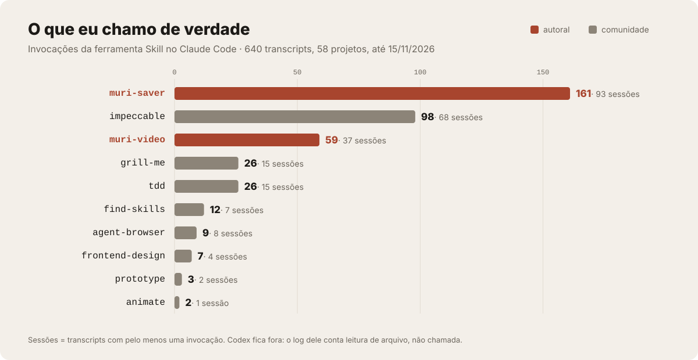
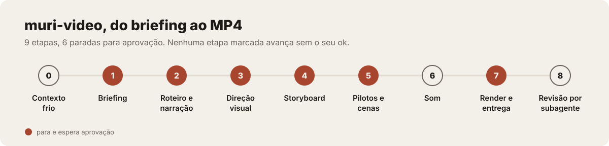

<!-- gerado:banner -->
<picture>
  <source media="(prefers-color-scheme: dark)" srcset="assets/readme/banner-escuro.svg">
  
</picture>
<!-- /gerado:banner -->

<p align="center">
  <b>Português</b> &nbsp;·&nbsp; <a href="README.en.md">English</a>
</p>

<p align="center">
  <a href="#skills-autorais">Skills autorais</a> &nbsp;·&nbsp;
  <a href="#stack-diária">Stack diária</a> &nbsp;·&nbsp;
  <a href="#como-instalar">Como instalar</a> &nbsp;·&nbsp;
  <a href="#como-os-números-foram-medidos">Metodologia</a> &nbsp;·&nbsp;
  <a href="https://github.com/murilolol/muri-saver">muri-saver</a>
</p>

As skills que eu uso todo dia no **Claude Code**, no **Codex** e no **Antigravity**. Duas são minhas e estão aqui inteiras. As outras são de outros autores e aparecem como uma stack curada: link, autor, licença, quanto eu uso e por quê. Nenhum código de terceiro é copiado para este repositório.

> [!NOTE]
> Os números vêm dos meus transcripts locais, não de pesquisa nem de estrela no GitHub. A [metodologia](#como-os-números-foram-medidos) explica a contagem e como repetir na sua máquina.

## Por que existe

Eu audito o meu próprio uso de agentes. Foi assim que nasceu o [muri-saver](https://github.com/murilolol/muri-saver): transcripts reais mostraram para onde a cota ia, e cada regra do kit responde a um achado medido. Este repositório aplica a mesma ideia às skills. Em vez de uma lista de favoritas, o que entra aqui é o que os logs dizem que eu chamo de verdade.

<!-- gerado:uso -->
<picture>
  <source media="(prefers-color-scheme: dark)" srcset="assets/readme/uso-escuro.svg">
  
</picture>
<!-- /gerado:uso -->

<!-- TODO: vídeo de apresentação feito com a própria muri-video. Subir o MP4 pelo editor web do GitHub e colar aqui a URL github.com/user-attachments/assets/<uuid>, seguida do link "abra o vídeo" em <sub> e da tabela 3×2 de quadros em assets/video/. -->

## Skills autorais

### muri-saver

Modo de economia agressiva de contexto e cota para agentes de código. Diga "muri saver" e a sessão passa a seguir regras curtas: não reler o que já leu, paralelizar chamadas independentes, texto antes de screenshot, sessões curtas por assunto. O modo vale até você desligar.

<!-- gerado:uso-muri-saver -->
<sub>161 invocações em 93 sessões no Claude Code · 52 menções no Codex</sub>
<!-- /gerado:uso-muri-saver -->

Esta pasta traz só a skill ([`skills/muri-saver/`](skills/muri-saver/)): o `SKILL.md` e as referências de agentes, auditoria, delegação e memória. O kit completo, com hooks, status line, guarda de contexto, nota viva no Obsidian e instalador, está em **[murilolol/muri-saver](https://github.com/murilolol/muri-saver)**.

### muri-video

Pipeline de vídeo de apresentação narrado: institucional, produto, resultados ou portfólio. A skill conduz o briefing em rodadas, escreve o roteiro para TTS, propõe três direções visuais, monta o storyboard e só então produz as cenas em Remotion (ou [HyperFrames](https://github.com/heygen-com/hyperframes), da HeyGen, Apache-2.0), com trilha, efeitos e render em 16:9 e 9:16, até 4K, com e sem trilha. No fim, um subagente revisa o filme antes da entrega.

<!-- gerado:uso-muri-video -->
<sub>59 invocações em 37 sessões no Claude Code · 1.369 menções no Codex</sub>
<!-- /gerado:uso-muri-video -->

<!-- gerado:pipeline -->
<picture>
  <source media="(prefers-color-scheme: dark)" srcset="assets/readme/pipeline-escuro.svg">
  
</picture>
<!-- /gerado:pipeline -->

O que vem na pasta [`skills/muri-video/`](skills/muri-video/):

| Caminho | O que é |
|---|---|
| `SKILL.md` | Fluxo, regras de ouro e ferramentas |
| `references/` | Briefing, narração, motion, Remotion, HyperFrames, som, render, divulgação, revisão e lições aprendidas |
| `cli/muri.mjs` | CLI `muri`: `novo`, `versao`, `status`, `entregar`, `arquivar`, `retomar`. Cada versão é um worktree e nunca é sobrescrita. Testes com `node --test` em `cli/` |
| `scripts/` | Projeto avulso a partir do template e ativação das skills do HyperFrames só dentro do projeto |
| `ferramentas/` | Pranchas de QA, análise de sincronia e níveis de áudio, captura de telas reais em 2× |
| `template/hyperframes/` | Composição base para peças curtas em HTML e GSAP |

> [!IMPORTANT]
> As cenas Remotion saem de um template próprio, que mora num repositório à parte e ainda não é público. Sem ele, `muri novo` e `scripts/novo-projeto.sh` param com "Template não encontrado". Aponte `MURI_VIDEO_REPO` para um repositório Remotion seu (branch `main`) ou use o motor HyperFrames, que funciona só com esta pasta.

Requisitos: Node 18+, FFmpeg, whisper-cpp e Python 3.11 para narração local (`brew install ffmpeg whisper-cpp` e `pip3 install kokoro-onnx soundfile transformers torch numpy`). Opcional: o app Orca (`MURI_ORCA_BIN`) para listar cada versão como worktree; sem ele o CLI só avisa e segue. A muri-video orquestra `video-shotcraft`, `remotion-best-practices` e `grill-me`, listadas na stack abaixo.

## Stack diária

Skills de outros autores que aparecem nos meus logs, ordenadas por invocações no Claude Code e depois por menções no Codex. Cada uma mantém a licença original; instale pelo comando do autor.

<!-- gerado:stack -->
| Skill | Autor | Licença | Claude Code¹ | Codex² | Por que está aqui |
|---|---|---|---|---|---|
| [`impeccable`](https://github.com/pbakaus/impeccable) | [Paul Bakaus](https://github.com/pbakaus) | Apache-2.0 | 98 em 68 sessões | 672 menções | Crítica e polimento de qualquer tela antes de entregar. A skill de terceiros que eu mais chamo. |
| [`grill-me`](https://github.com/mattpocock/skills) | [Matt Pocock](https://github.com/mattpocock) | MIT | 26 em 15 sessões | 11 menções | Antes de plano grande: perguntas em rodadas até não sobrar ponta solta. A muri-video pergunta desse jeito. |
| [`tdd`](https://github.com/mattpocock/skills) | [Matt Pocock](https://github.com/mattpocock) | MIT | 26 em 15 sessões | 10 menções | Bug e feature começam pelo teste que falha, com teste de integração no lugar de mock. |
| [`find-skills`](https://github.com/vercel-labs/skills) | [Vercel Labs](https://github.com/vercel-labs) | MIT | 12 em 7 sessões | — | Antes de escrever uma skill, confiro se alguém já escreveu. |
| [`agent-browser`](https://github.com/vercel-labs/agent-browser) | [Vercel Labs](https://github.com/vercel-labs) | Apache-2.0 | 9 em 8 sessões | 29 menções | Testar o app num navegador de verdade sem sair do terminal. Precisa do CLI agent-browser. |
| [`frontend-design`](https://github.com/anthropics/skills/tree/main/skills/frontend-design) | [Anthropic](https://github.com/anthropics) | Apache-2.0 | 7 em 4 sessões | 20 menções | Direção visual quando a tela começa do zero. |
| [`prototype`](https://github.com/emilkowalski/skills) | [Emil Kowalski](https://github.com/emilkowalski) | MIT | 3 em 2 sessões | — | Três ou quatro versões de um componente num seletor, para decidir vendo e não imaginando. |
| [`animate`](https://github.com/emilkowalski/skills) | [Emil Kowalski](https://github.com/emilkowalski) | MIT | 2 em 1 sessão | 59 menções | Decide se algo deve animar antes de decidir como. |
| [`video-shotcraft`](https://github.com/Vincentwei1021/video-shotcraft) | [Wei Yihao (Vincent Wei)](https://github.com/Vincentwei1021) | Apache-2.0 | — | 1.535 menções | Galeria de planos e biblioteca de som que a muri-video orquestra. Entra carregada por ela. |
| [`emil-design-eng`](https://github.com/emilkowalski/skills) | [Emil Kowalski](https://github.com/emilkowalski) | MIT | — | 64 menções | Critério de polimento de interface e motion quando o trabalho de UI está no Codex. |
| [`test-driven-development`](https://github.com/obra/superpowers) | [Jesse Vincent](https://github.com/obra) | MIT | — | 62 menções | TDD estrito do Superpowers, o par da tdd do lado do Codex. |
| [`graphify`](https://github.com/Graphify-Labs/graphify) | [Graphify Labs](https://github.com/Graphify-Labs) | Apache-2.0 | — | 46 menções | Pergunto ao grafo do repo antes de sair dando grep. No Claude roda pelo CLI, por isso não aparece como invocação. |
| [`design-taste-frontend`](https://github.com/Leonxlnx/taste-skill) | [Leonxlnx](https://github.com/Leonxlnx) | MIT | — | 24 menções | Segunda opinião contra layout com cara de template em landing page. |
| [`remotion-best-practices`](https://github.com/remotion-dev/skills) | [Remotion](https://github.com/remotion-dev) | sem arquivo de licença | — | 16 menções | API do Remotion quando surge uma dúvida pontual no meio de um vídeo. |

<sub>¹ Invocações da ferramenta Skill, e em quantas sessões.<br>² Menções a caminhos da skill nos logs do Codex. Infla com cada arquivo lido, então serve para ordem de grandeza, não para comparar com o Claude.<br>Ficaram fora da tabela: skills nativas do cliente (computer-use, claude-in-chrome, chrome-browser, dataviz, design, web-design-guidelines), skills locais ou privadas, a openspec local e o gstack (54 menções no Codex), que é um pacote de 23 ferramentas e não uma skill só.</sub>
<!-- /gerado:stack -->

## Como instalar

**Skills autorais.** Copie a pasta da skill para o diretório de skills do seu agente:

```bash
git clone https://github.com/murilolol/muri-skills.git
for s in muri-saver muri-video; do
  cp -R muri-skills/skills/$s ~/.claude/skills/   # Claude Code lê ~/.claude/skills
  cp -R muri-skills/skills/$s ~/.agents/skills/   # Codex, Antigravity e outros leem ~/.agents/skills
done
```

Para usar o CLI da muri-video como `muri`: `ln -s "$PWD/muri-skills/skills/muri-video/cli/muri.mjs" ~/.local/bin/muri`. Por padrão os vídeos ficam em `~/videos/muri-video`; mude com `MURI_ORCA_RAIZ`.

**Stack de terceiros.** Use o comando oficial de cada autor:

<!-- gerado:instalar -->
<details>
<summary>Comandos de instalação de cada skill da stack</summary>

```bash
# impeccable (Paul Bakaus, Apache-2.0)
npx impeccable install

# grill-me (Matt Pocock, MIT)
npx skills@latest add mattpocock/skills --skill grill-me

# tdd (Matt Pocock, MIT)
npx skills@latest add mattpocock/skills --skill tdd

# find-skills (Vercel Labs, MIT)
npx skills add vercel-labs/skills --skill find-skills

# agent-browser (Vercel Labs, Apache-2.0)
npx skills add vercel-labs/agent-browser

# frontend-design (Anthropic, Apache-2.0), dentro do Claude Code
/plugin marketplace add anthropics/skills
/plugin install example-skills@anthropic-agent-skills

# prototype (Emil Kowalski, MIT)
npx skills@latest add emilkowalski/skills --skill prototype

# animate (Emil Kowalski, MIT)
npx skills@latest add emilkowalski/skills --skill animate

# video-shotcraft (Wei Yihao (Vincent Wei), Apache-2.0)
npx skills add Vincentwei1021/video-shotcraft

# emil-design-eng (Emil Kowalski, MIT)
npx skills@latest add emilkowalski/skills --skill emil-design-eng

# test-driven-development (Jesse Vincent, MIT), dentro do Claude Code
/plugin install superpowers@claude-plugins-official

# graphify (Graphify Labs, Apache-2.0)
uv tool install graphifyy && graphify install

# design-taste-frontend (Leonxlnx, MIT)
npx skills add https://github.com/Leonxlnx/taste-skill --skill "design-taste-frontend"

# remotion-best-practices (Remotion, sem arquivo de licença)
npx skills add remotion-dev/skills
```

</details>
<!-- /gerado:instalar -->

## Como os números foram medidos

- **Claude Code:** cada bloco `tool_use` da ferramenta `Skill` nos transcripts locais (`~/.claude/projects/**/*.jsonl`) conta uma invocação. Sessões são os transcripts com pelo menos uma invocação daquela skill.
- **Codex:** cada caminho `<skill>/` citado nos logs de `~/.codex/sessions` conta uma menção. Leitura de arquivo dentro da skill também conta, por isso uma skill grande como a `video-shotcraft` aparece com milhares de menções. Serve para ordem de grandeza, não para comparar com o Claude.
- **Antigravity:** fica fora desta medição.
- **Fora da tabela:** skills que vêm com o cliente, skills locais sem upstream conferido e qualquer skill privada.
- **Upstream:** repositório, autor, licença e comando de instalação de cada skill foram conferidos no GitHub na data da medição.

Para repetir no Claude Code:

```bash
find ~/.claude/projects -name '*.jsonl' \
  -exec grep -oh '"name":"Skill","input":{"skill":"[^"]*"' {} + \
  | sed 's/.*"skill":"//; s/"$//' | sort | uniq -c | sort -rn
```

Os números do README, do banner e dos gráficos vêm de um arquivo só, [`assets/readme/dados.json`](assets/readme/dados.json). `npm run build` regera os 12 SVGs (claro e escuro, português e inglês) e reescreve as partes geradas dos dois READMEs; o script confere os dados antes de escrever.

## Licença e créditos

As skills autorais (`skills/muri-saver` e `skills/muri-video`) e os scripts deste repositório estão sob a licença MIT ([`LICENSE`](LICENSE)). As skills da stack não são distribuídas aqui e seguem a licença de cada autor: [Paul Bakaus](https://github.com/pbakaus), [Matt Pocock](https://github.com/mattpocock), [Emil Kowalski](https://github.com/emilkowalski), [Vercel Labs](https://github.com/vercel-labs), [Anthropic](https://github.com/anthropics), [Jesse Vincent](https://github.com/obra), [Graphify Labs](https://github.com/Graphify-Labs), [Wei Yihao (Vincent Wei)](https://github.com/Vincentwei1021), [Leonxlnx](https://github.com/Leonxlnx) e [Remotion](https://github.com/remotion-dev). O motor [HyperFrames](https://github.com/heygen-com/hyperframes), que a muri-video ativa por projeto, é da [HeyGen](https://github.com/heygen-com) (Apache-2.0).

Feito por [@murilolol](https://github.com/murilolol).

<sub>O banner e os gráficos são gerados a partir de <a href="assets/readme/dados.json">assets/readme/dados.json</a> com <a href="tools/build-assets.mjs">tools/build-assets.mjs</a>. O mascote é o Pavio, o mesmo do muri-saver.</sub>
