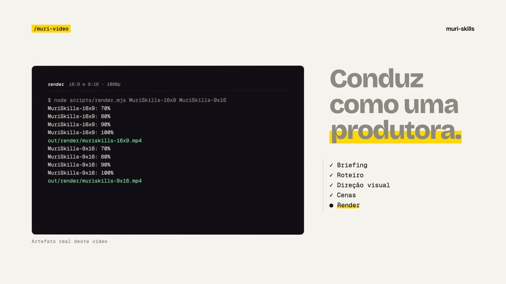
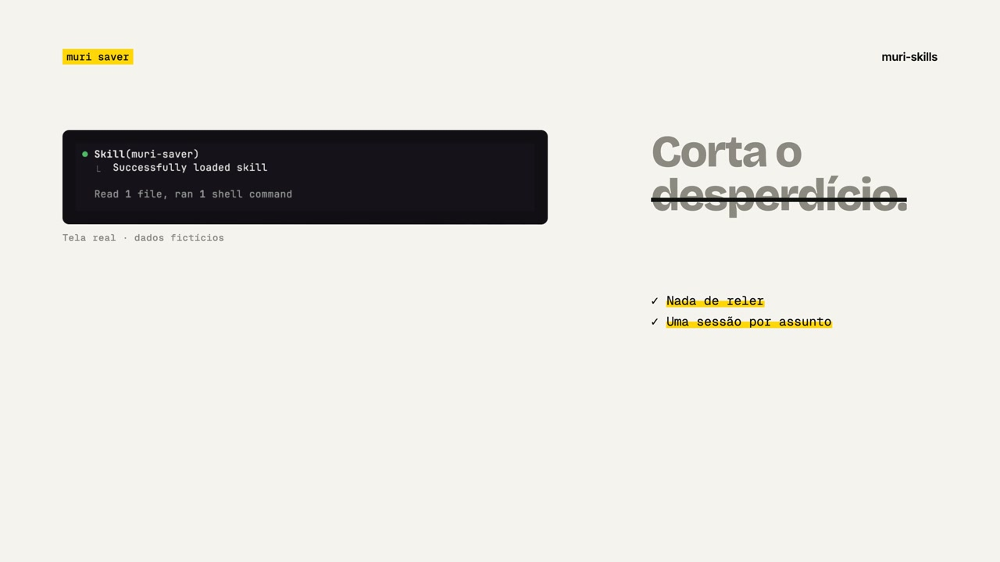
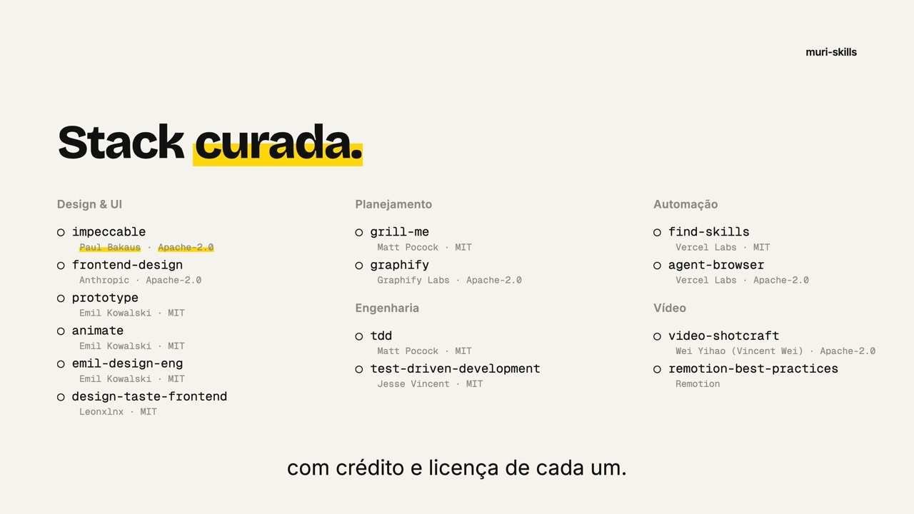

<picture>
  <source media="(prefers-color-scheme: dark)" srcset="assets/readme/hero-dark.svg?v=2">
  
</picture>

<p align="center">
  <b>Português</b> &nbsp;·&nbsp; <a href="README.en.md">English</a>
</p>

<p align="center">
  <a href="#01--muri-video">muri-video</a> &nbsp;·&nbsp;
  <a href="#02--muri-saver">muri-saver</a> &nbsp;·&nbsp;
  <a href="#03--muri-design">muri-design</a> &nbsp;·&nbsp;
  <a href="#04--stack-curada">Stack curada</a> &nbsp;·&nbsp;
  <a href="#como-instalar">Como instalar</a>
</p>

Uma skill é uma pasta com um `SKILL.md`: instruções, referências e scripts que o agente de código carrega sozinho quando a tarefa pede. Este repositório reúne as três skills que eu escrevi e a stack de terceiros que uso junto com elas, com crédito a cada autor.

É para quem trabalha com **Claude Code**, **Codex** ou **Antigravity** e quer que o agente entregue trabalho com acabamento, não rascunho. Instale só o que resolve o seu problema.

https://github.com/user-attachments/assets/55dd9c05-ae6c-4bb2-bb28-1ceb2cdea539

<sub><b>Ligue o som:</b> o vídeo é narrado e o player do GitHub começa mudo. Se não carregar, <a href="https://github.com/user-attachments/assets/55dd9c05-ae6c-4bb2-bb28-1ceb2cdea539">abra o vídeo</a>. Feito com a própria muri-video, em 58 s; telas reais do agente num projeto fictício.</sub>

<details>
<summary>Transcrição</summary>

Agentes de código escrevem rápido. Mas entregam pela metade: o rascunho parece pronto, e o acabamento sobra pra você.

O muri-skills muda isso. São skills, instruções que o agente carrega sozinho, para trabalhar com processo do pedido à entrega.

Peça um vídeo, e a muri-video conduz como uma produtora: briefing, roteiro, direção visual, cenas e render. A cada etapa, ela para e espera o seu ok. Este vídeo foi feito assim.

Em sessão longa, o muri-saver corta o desperdício: o agente não relê o que já leu, sugere sessão nova quando o assunto muda, e não pula nenhum teste para economizar.

Para o resto, uma stack curada de outros autores, com crédito e licença de cada um. Instale só o que resolve.

Funciona no Claude Code, no Codex e no Antigravity. Uma linha para instalar. Grátis e de código aberto.

</details>

<table>
  <tr>
    <td width="33%"><br><sub><b>O problema:</b> o rascunho parece pronto</sub></td>
    <td width="33%"><br><sub><b>A ideia:</b> instruções que o agente carrega sozinho</sub></td>
    <td width="33%"><br><sub><b>muri-video:</b> para em cada etapa pro seu ok</sub></td>
  </tr>
  <tr>
    <td><br><sub><b>muri-saver:</b> nada de reler, uma sessão por assunto</sub></td>
    <td><br><sub><b>Stack:</b> crédito e licença de cada autor</sub></td>
    <td><br><sub><b>Instalar:</b> uma linha</sub></td>
  </tr>
</table>

## 01 · muri-video

<picture>
  <source media="(prefers-color-scheme: dark)" srcset="assets/readme/card-muri-video-dark.svg?v=2">
  
</picture>

<!-- gerado:muri-video -->
**Para que serve.** Conduz o agente por um processo de produtora para fazer vídeo institucional, de produto, de resultados ou de portfólio. Ele faz o briefing em rodadas de perguntas, escreve o roteiro para a voz, propõe direções visuais e storyboard e produz as cenas em Remotion (ou HyperFrames) com câmera 2.5D, som e legenda. Cada etapa marcada com ✋ pausa e espera a sua aprovação.

**Quando usar.** Institucional · lançamento de produto · resultados e dados · portfólio · vídeo para redes. Peça assim: `muri video, faz o vídeo de lançamento do app`

**O que você recebe.** Quatro MP4 (16:9 e 9:16, com e sem trilha, até 4K) e legenda VTT; quando você pede, peças de story e feed com texto por rede e uma revisão final por subagente.

```bash
npx skills add murilolol/muri-skills --skill muri-video
```
<!-- /gerado:muri-video -->

<details>
<summary>Como funciona, etapa por etapa</summary>

Cada ✋ é um ponto em que a skill para e espera o seu ok.

0. **Contexto frio.** Lê memória, tokens de tema, telas e a origem dos dados do produto.
1. **Briefing ✋.** Rodadas de perguntas com a opção recomendada primeiro, no estilo do `grill-me`.
2. **Roteiro e narração ✋.** Texto por cena escrito para a voz; o texto é aprovado antes de gastar cota de TTS.
3. **Direção visual ✋.** Três styleframes lado a lado; você escolhe um.
4. **Storyboard ✋.** Parte, tempo, o que aparece, plano e som de cada trecho.
5. **Produção ✋.** Dois pilotos primeiro, com QA de quadros em 16:9 e 9:16; depois as outras cenas, uma por vez.
6. **Som.** Trilha e efeitos depois que o visual trava, com o pico de cada som no quadro da ação.
7. **Render e entrega ✋.** Formatos em paralelo, áudio a −16 LUFS, VTT e os quatro MP4; peças de divulgação quando pedidas.
8. **Revisão final.** Um subagente revisa o filme; as correções obrigatórias entram antes da entrega.

**Motor.** Remotion por padrão, para vídeo longo dirigido pela narração e cheio de dados. [HyperFrames](https://github.com/heygen-com/hyperframes) (HeyGen, Apache-2.0) para peças curtas em HTML e GSAP; as skills dele são ativadas só dentro do projeto.

| Caminho | O que é |
|---|---|
| `SKILL.md` | Fluxo, regras de ouro e ferramentas |
| `references/` | Briefing, narração, motion, Remotion, HyperFrames, som, render, divulgação, revisão e lições aprendidas |
| `cli/muri.mjs` | CLI `muri`: `novo`, `versao`, `status`, `entregar`, `arquivar`, `retomar`. Cada versão é um worktree e nunca é sobrescrita |
| `scripts/` | Projeto avulso a partir do template e ativação das skills do HyperFrames por projeto |
| `ferramentas/` | Pranchas de QA, análise de sincronia e níveis de áudio, captura de telas reais em 2× |
| `template/hyperframes/` | Composição base para peças curtas |

**Requisitos (macOS, Linux e Windows).** Node 22+, FFmpeg, whisper-cpp e `chrome-headless-shell`; Python 3 para narração local e análise de batida (`kokoro-onnx soundfile transformers torch numpy librosa`). Os scripts são Node (`node …/*.mjs`), sem bash; comandos de instalação por sistema em [`references/versoes.md`](skills/muri-video/references/versoes.md) e `muri doctor` confere o ambiente.

> [!IMPORTANT]
> As cenas Remotion saem de um template próprio que ainda não é público. Sem ele, `muri novo` para com "Template não encontrado": aponte `MURI_VIDEO_REPO` para um repositório Remotion seu (branch `main`) ou use o motor HyperFrames, que funciona só com esta pasta.

</details>

## 02 · muri-saver

<picture>
  <source media="(prefers-color-scheme: dark)" srcset="assets/readme/card-muri-saver-dark.svg?v=2">
  
</picture>

<!-- gerado:muri-saver -->
**Para que serve.** Um modo que fica ligado a conversa inteira e muda o jeito como o agente trabalha. Ele busca antes de ler, nunca relê o que já está no contexto, agrupa chamadas independentes, prefere o texto da página a um screenshot e sugere sessão nova quando o assunto muda. Com o kit completo, o trabalho mecânico vai para outra cota (o Gemini varre e resume, o Codex revisa e implementa com o seu ok) e o handoff entre sessões é automático.

**Quando usar.** Sessão longa e lenta · agente relendo arquivo · cota acabando antes do fim da semana · tarefa mecânica pesada. Peça assim: `muri saver`

**O que você recebe.** Respostas diretas, menos leitura repetida e sessões que terminam na hora certa, para a cota do plano durar a semana. Nenhum teste necessário é pulado e nenhum requisito é cortado para economizar.

```bash
npx skills add murilolol/muri-skills --skill muri-saver
```
<!-- /gerado:muri-saver -->

Liga com `muri saver` e vale até você dizer `sair do muri-saver` ou pedir para desligar. Esta pasta traz a skill e as regras; a delegação e o handoff automático vêm com o **[kit completo](https://github.com/murilolol/muri-saver)**, que tem os hooks, a guarda de contexto, a status line, o delegador para Gemini e Codex e o instalador.

<details>
<summary>Regras, delegação e perfis por tipo de tarefa</summary>

**Regras que ficam ligadas**

- Respostas sem preâmbulo e sem recapitular; nada de repetir código ou saída que já apareceu.
- Busca antes de ler, lê o trecho, nunca relê um arquivo que já está no contexto.
- Chamadas independentes saem juntas; schemas de ferramenta carregados uma vez.
- Nunca troca de modelo sozinha; tarefa mecânica em esforço alto vira uma sugestão de uma frase.
- Tarefa concluída e pedido novo sem relação: sugere sessão nova; com o kit, o handoff é automático.
- Nunca pula um teste necessário, corta requisito ou para antes do fim para economizar.

**Quem faz o quê** (com o kit completo)

| Tarefa | Quem |
|---|---|
| Varredura ampla, "como X funciona", resumo de log, pesquisa, rascunho de doc | Gemini |
| Revisão de código, segunda opinião | Codex, só leitura |
| Implementação bem especificada, boilerplate, refatoração em massa, testes | Codex com escrita, depois do seu ok |
| Arquitetura, decisão ambígua, revisão final do diff, conversa | o seu agente |

**Perfis.** Backend, frontend, navegador e QA, docs, git, debug, scaffold e refatoração têm regras próprias no [`SKILL.md`](skills/muri-saver/SKILL.md).

</details>

## 03 · muri-design

<picture>
  <source media="(prefers-color-scheme: dark)" srcset="assets/readme/card-muri-design-dark.svg?v=2">
  
</picture>

<!-- gerado:muri-design -->
**Para que serve.** As regras que eu aplico quando desenho para um produto, tiradas do que eu aprovei e reprovei em projetos reais. O agente lê a identidade do produto antes de desenhar, usa uma base lisa com um acento só, mostra telas reais em vez de UI inventada, corta efeito decorativo e dá a cada tela um layout próprio. O processo vem junto: briefing curto, três opções lado a lado, piloto aprovado antes de escalar, QA em prancha e revisão independente.

**Quando usar.** Interface ou site novo · redesign · carrossel e post · README e visual de produto. Peça assim: `muri design`

**O que você recebe.** Visual com a cara do produto e sem cara de template, um checklist de reprovação aplicado antes de te mostrar qualquer coisa e um ponto de aprovação antes de escalar. Para execução e polimento, combina com impeccable, emil-design-eng e frontend-design da stack.

```bash
npx skills add murilolol/muri-skills --skill muri-design
```
<!-- /gerado:muri-design -->

As regras completas, o processo e o checklist de reprovação estão no [`SKILL.md`](skills/muri-design/SKILL.md). Elas vêm de feedback real que eu dei em projetos, aprovando e reprovando trabalho; onde coincidem com skills da stack, o crédito está no fim do arquivo.

## 04 · Stack curada

<picture>
  <source media="(prefers-color-scheme: dark)" srcset="assets/readme/stack-dark.svg?v=2">
  
</picture>

Skills de outros autores que trabalham junto com as minhas. Nenhum código delas é copiado para cá: cada uma mantém a licença original e é instalada pelo comando do autor.

<!-- gerado:stack -->
<details>
<summary><b>Design & UI</b> · impeccable, frontend-design, prototype, animate, emil-design-eng, design-taste-frontend</summary>

| Skill | Para que serve | Peça assim |
|---|---|---|
| [`impeccable`](https://github.com/pbakaus/impeccable)<br><sub>[Paul Bakaus](https://github.com/pbakaus) · Apache-2.0</sub> | Um kit de design para o agente: crítica, auditoria, polimento, tipografia, cor, layout, motion e acessibilidade de telas web. Aponta o que parece genérico e corrige.<br><sub>Entrega: Diagnóstico priorizado e a tela ajustada.</sub> | <sub>“faz uma crítica dessa tela antes de eu publicar”</sub> |
| [`frontend-design`](https://github.com/anthropics/skills/tree/main/skills/frontend-design)<br><sub>[Anthropic](https://github.com/anthropics) · Apache-2.0</sub> | Orienta a direção estética, a tipografia e a composição quando uma interface nasce ou muda de cara, para ela não sair com cara de template.<br><sub>Entrega: Uma interface com direção visual clara e coerente.</sub> | <sub>“cria a landing page desse produto”</sub> |
| [`prototype`](https://github.com/emilkowalski/skills)<br><sub>[Emil Kowalski](https://github.com/emilkowalski) · MIT</sub> | Gera versões realmente diferentes de uma peça de UI, que você alterna num seletor visual e promove a melhor. Só roda quando chamada.<br><sub>Entrega: As variações lado a lado e a escolhida promovida.</sub> | <sub>“/prototype três versões do card de preço”</sub> |
| [`animate`](https://github.com/emilkowalski/skills)<br><sub>[Emil Kowalski](https://github.com/emilkowalski) · MIT</sub> | Constrói uma animação tomando as decisões na ordem certa: se deve animar, com que propósito, qual ferramenta, propriedades, curva, duração, interrupção e saída. Escreve a implementação.<br><sub>Entrega: A animação implementada, com curva e duração justificadas.</sub> | <sub>“anima a abertura desse modal”</sub> |
| [`emil-design-eng`](https://github.com/emilkowalski/skills)<br><sub>[Emil Kowalski](https://github.com/emilkowalski) · MIT</sub> | Traz a filosofia de Emil Kowalski sobre polimento de UI, design de componente e decisão de animação: os detalhes que fazem um software parecer bem acabado.<br><sub>Entrega: Ajustes finos de interação, motion e componente.</sub> | <sub>“revisa o acabamento desse componente”</sub> |
| [`design-taste-frontend`](https://github.com/Leonxlnx/taste-skill)<br><sub>[Leonxlnx](https://github.com/Leonxlnx) · MIT</sub> | Skill anti-template para landing page, portfólio e redesign. Lê o briefing, infere a direção, audita antes de redesenhar e passa um checklist rígido antes de entregar.<br><sub>Entrega: Um layout com direção própria, conferido antes da entrega.</sub> | <sub>“redesenha a home sem cara de template”</sub> |

</details>

<details>
<summary><b>Planejamento</b> · grill-me, graphify</summary>

| Skill | Para que serve | Peça assim |
|---|---|---|
| [`grill-me`](https://github.com/mattpocock/skills)<br><sub>[Matt Pocock](https://github.com/mattpocock) · MIT</sub> | O agente entrevista você sobre cada decisão de um plano até os dois chegarem ao mesmo entendimento. Serve para pedido grande que ainda tem ponta solta. Só roda quando chamada.<br><sub>Entrega: Um plano sem ambiguidade, com as decisões registradas.</sub> | <sub>“/grill-me esse plano antes de começar”</sub> |
| [`graphify`](https://github.com/Graphify-Labs/graphify)<br><sub>[Graphify Labs](https://github.com/Graphify-Labs) · Apache-2.0</sub> | Transforma código, docs, PDFs e mídia num grafo de conhecimento persistente, com comandos query, path e explain. O agente pergunta ao grafo antes de sair lendo arquivo por arquivo.<br><sub>Entrega: A resposta com os nós e os caminhos do grafo.</sub> | <sub>“como o pagamento se conecta com a fila?”</sub> |

</details>

<details>
<summary><b>Engenharia</b> · tdd, test-driven-development</summary>

| Skill | Para que serve | Peça assim |
|---|---|---|
| [`tdd`](https://github.com/mattpocock/skills)<br><sub>[Matt Pocock](https://github.com/mattpocock) · MIT</sub> | Conduz feature e correção de bug pelo ciclo red-green-refactor em fatias verticais. Os testes verificam comportamento pela interface pública, não detalhe de implementação.<br><sub>Entrega: Código coberto por testes que sobrevivem à refatoração.</sub> | <sub>“corrige esse bug começando pelo teste”</sub> |
| [`test-driven-development`](https://github.com/obra/superpowers)<br><sub>[Jesse Vincent](https://github.com/obra) · MIT</sub> | Parte do Superpowers. Impõe a regra: nenhum código de produção sem um teste que falhou antes. Escreve o teste, vê falhar pelo motivo certo e só então escreve o mínimo para passar.<br><sub>Entrega: Cada mudança acompanhada do teste que a justifica.</sub> | <sub>“implementa o filtro por data”</sub> |

</details>

<details>
<summary><b>Automação</b> · find-skills, agent-browser</summary>

| Skill | Para que serve | Peça assim |
|---|---|---|
| [`find-skills`](https://github.com/vercel-labs/skills)<br><sub>[Vercel Labs](https://github.com/vercel-labs) · MIT</sub> | Quando aparece um "tem skill para isso?", procura no ecossistema aberto de skills e mostra como instalar a que resolve.<br><sub>Entrega: As opções encontradas, com o comando de instalação.</sub> | <sub>“existe alguma skill para revisar acessibilidade?”</sub> |
| [`agent-browser`](https://github.com/vercel-labs/agent-browser)<br><sub>[Vercel Labs](https://github.com/vercel-labs) · Apache-2.0</sub> | Ensina o agente a usar o CLI agent-browser para abrir páginas, clicar, preencher formulários e ler a tela. Serve para testar o app de verdade e fazer QA exploratório. Precisa do CLI instalado.<br><sub>Entrega: O fluxo executado, com o que quebrou e a evidência.</sub> | <sub>“abre o app local e testa o fluxo de cadastro”</sub> |

</details>

<details>
<summary><b>Vídeo</b> · video-shotcraft, remotion-best-practices</summary>

| Skill | Para que serve | Peça assim |
|---|---|---|
| [`video-shotcraft`](https://github.com/Vincentwei1021/video-shotcraft)<br><sub>[Wei Yihao (Vincent Wei)](https://github.com/Vincentwei1021) · Apache-2.0</sub> | Transforma um projeto front-end em vídeo de produto com cartões de receita de plano, template validado em Remotion, telas reais, câmera 2.5D, cortes no ritmo e design de som. A muri-video usa essa skill na etapa de produção.<br><sub>Entrega: Um vídeo de produto em Remotion feito das telas reais.</sub> | <sub>“transforma essa landing page num vídeo de produto”</sub> |
| [`remotion-best-practices`](https://github.com/remotion-dev/skills)<br><sub>[Remotion](https://github.com/remotion-dev) · sem arquivo de licença</sub> | Roteador oficial para as referências do Remotion: criar projeto e composição, boas práticas de markup e temas específicos, carregados conforme a dúvida.<br><sub>Entrega: A resposta pela referência oficial, aplicada no código.</sub> | <sub>“como faço um mapa animado no Remotion?”</sub> |

</details>
<!-- /gerado:stack -->

<!-- gerado:instalar -->
<details>
<summary>Comandos de instalação de cada skill da stack</summary>

```bash
# impeccable (Paul Bakaus, Apache-2.0)
npx impeccable install

# grill-me (Matt Pocock, MIT)
npx skills@latest add mattpocock/skills --skill grill-me

# tdd (Matt Pocock, MIT)
npx skills@latest add mattpocock/skills --skill tdd

# find-skills (Vercel Labs, MIT)
npx skills add vercel-labs/skills --skill find-skills

# agent-browser (Vercel Labs, Apache-2.0)
npx skills add vercel-labs/agent-browser

# frontend-design (Anthropic, Apache-2.0), dentro do Claude Code
/plugin marketplace add anthropics/skills
/plugin install example-skills@anthropic-agent-skills

# prototype (Emil Kowalski, MIT)
npx skills@latest add emilkowalski/skills --skill prototype

# animate (Emil Kowalski, MIT)
npx skills@latest add emilkowalski/skills --skill animate

# video-shotcraft (Wei Yihao (Vincent Wei), Apache-2.0)
npx skills add Vincentwei1021/video-shotcraft

# emil-design-eng (Emil Kowalski, MIT)
npx skills@latest add emilkowalski/skills --skill emil-design-eng

# test-driven-development (Jesse Vincent, MIT), dentro do Claude Code
/plugin install superpowers@claude-plugins-official

# graphify (Graphify Labs, Apache-2.0)
uv tool install graphifyy && graphify install

# design-taste-frontend (Leonxlnx, MIT)
npx skills add https://github.com/Leonxlnx/taste-skill --skill "design-taste-frontend"

# remotion-best-practices (Remotion, sem arquivo de licença)
npx skills add remotion-dev/skills
```

</details>
<!-- /gerado:instalar -->

## Como instalar

**Pelo CLI de skills** (detecta os agentes instalados na máquina):

```bash
npx skills add murilolol/muri-skills                      # lista as três e pergunta
npx skills add murilolol/muri-skills --skill muri-video   # só uma
```

**À mão:** copie a pasta da skill para o diretório que o seu agente lê.

```bash
git clone https://github.com/murilolol/muri-skills.git
cp -R muri-skills/skills/muri-video ~/.claude/skills/   # Claude Code
cp -R muri-skills/skills/muri-video ~/.agents/skills/   # Codex, Antigravity e outros
```

Para usar o CLI da muri-video como `muri`: `ln -s "$PWD/muri-skills/skills/muri-video/cli/muri.mjs" ~/.local/bin/muri`. Os vídeos ficam em `~/videos/muri-video`; mude com `MURI_ORCA_RAIZ`.

## Licença e créditos

As skills autorais (`skills/muri-design`, `skills/muri-saver` e `skills/muri-video`) e os scripts deste repositório estão sob a licença MIT ([`LICENSE`](LICENSE)). As skills da stack não são distribuídas aqui e seguem a licença de cada autor, indicada acima. O motor [HyperFrames](https://github.com/heygen-com/hyperframes), que a muri-video ativa por projeto, é da [HeyGen](https://github.com/heygen-com) (Apache-2.0).

Feito por [Murilo Silva](https://github.com/murilolol).

<sub>As imagens e as tabelas desta página são geradas de <a href="assets/readme/dados.json">assets/readme/dados.json</a> por <a href="tools/build-assets.mjs">tools/build-assets.mjs</a> (<code>npm run build</code>). Tipografia: Geist e Geist Mono, SIL Open Font License 1.1.</sub>
